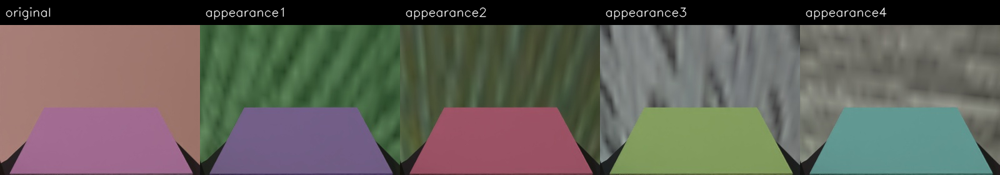
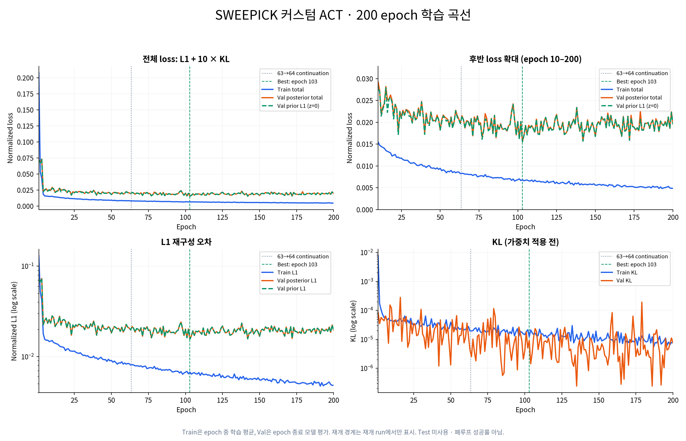

# CUSTOM ACT V1 | 관측과 행동이 이어지는지 확인한 기록

SWEEPICK에서 학습 정책을 적용할 때, 낮은 예측 손실만으로는 물체를 끝까지 옮기는지 알 수 없었다. 시연의 외형을 늘리는 단계부터 분할, 모델 학습, 폐루프 실행과 실패 분석까지 같은 기록으로 연결했다.

**ACT는 팀원과 공동 개발·검증했다. 전형주 주 담당은 모방학습·시뮬레이션·Sim-to-Real·데이터 검증이며, Visual SLAM은 협업으로 참여했다.** 아래 ACT 수치는 공동 실험 결과다. 개인 담당 경험과 연결해 설명하되, 외부 ACT·RoboTwin 구현과 팀 기여의 출처도 함께 남긴다.

[프로젝트](../README.md) · [그림·영상으로 보기](https://julianjeonresume.netlify.app/research/custom-act-v1/) · [공개 후속 요약](#실물-연동과-후속-기록)(접근 권한 필요) · [이전 접촉·계획 연구](RESEARCH_SUMMARY_KO.md)

## 1. 데이터 수집 — 동작을 보존하고 외형을 바꿨다

원본113개 궤적에 각4개 외형을 더해 총565개 뷰를 구성했다. 같은 상태·관절 동작에서 손목 RGB의 물체색, 테이블·벽 텍스처와 조명을 다시 렌더링했다. 565개는 서로 다른 물리 시연565회가 아니라 113개 동작의 외형5종이다.

| 분할 | 원본 궤적 | 외형 뷰 |
|---|---:|---:|
| Train | 59 | 295 |
| Validation | 29 | 145 |
| Test | 25 | 125 |
| 합계 | 113 | 565 |

관절 상태·명령·시각·물체 pose와 head depth/PCD가 같은지 검사했다. 한 궤적의 외형 변형은 같은 분할에 묶어, 같은 동작이 학습과 평가에 나뉘어 들어가지 않게 했다. 정책 입력은 관절q·head PCD·양손목 RGB이며, 정답 행동·phase·물체 정답pose를 추론 입력에서 제외했다.

## 2. 학습 — 학습 곡선과 작업 완료를 따로 확인했다

shared wrist ResNet18+1×1 projection, hidden256, chunk20, state/action12, KL10, prior z=0 구성으로200 epoch 학습을 완료했다. epoch1~3은 batch4, 이후는 batch32였으며 epoch63 이후 재개한 기록을 포함한다.

| 지표 | 기록 |
|---|---:|
| Best validation prior normalized L1 | 0.01553423676 (epoch103) |
| Epoch200 validation prior normalized L1 | 0.01951522965 |

최저 검증 손실은 epoch103에서 나왔다. 이200 epoch 실행의 최종·best 모델은 원본 묶음에서 폐루프 평가되지 않았다. 다음 절의 작업 완료율은 별도로 고정한 epoch30 체크포인트의 결과다.

## 3. 추론 — 고정한 모델로143개 위치를 실행했다

epoch30 체크포인트와 temporal ensemble ON(k=0.01), prior z=0을 고정해143개 위치를 각1회 평가했다. 완료 기준은 **Lift≥30mm → measured Stow(오차0.025rad 이내) → 상승·접촉 상태를 물리2초 유지**다.

| 위치 구분 | 완료/시도 | 관측 완료율 |
|---|---:|---:|
| Train 영역 | 76/80 | 95.0% |
| Validation 영역 | 29/32 | 90.6% |
| Test 영역 | 27/31 | 87.1% |
| 전체 | 132/143 | 92.3% |

블록색·테이블/벽 텍스처·조명을 랜덤화했다. 물체 크기40mm·yaw·물성·카메라 보정은 고정했다. Test 결과로 평가 체크포인트를 바꾸거나 선택하지 않았고 Test expert HDF5는 학습에 사용하지 않았다. Train영역80개는 학습에 쓴59개와 그 외21개를 포함하며, 그 결과는 각각59/59와17/21이다.

143개 위치 각1회의 SIM 조작 평가이므로 이 값을 실물 성공률·반복 신뢰도·양팔 동시 조작 성능이나 전체 이동·청소·충전 과제의 완료율로 확대하지 않는다.

- [143개 위치별 공개 결과 CSV](evidence/custom_act_v1_20261027_positions.csv)
- [조건·집계 공개 요약 JSON](evidence/custom_act_v1_20261027_summary.json)
- [작업공간 분포](https://julianjeonresume.netlify.app/assets/custom-act-v1/evaluation-workspace.svg)
- [Test mid00_01 대표 SIM 영상](https://julianjeonresume.netlify.app/assets/custom-act-v1/sim-test-mid00_01.mp4)

## 4. 분석 — 예측 청크가 명령이 되는 과정을 추적했다

실패11회는 grasp/lift7회와 stow4회로 나눴다. query 시점, 예측 horizon, 실제 target 시점, 집계 가중치, 전송 명령, 실측 관절, phase와 영상을 함께 읽었다. 저장된17,280개 예측 행·15,000개 후보 행·864개 실행 행을 재계산했을 때 target정렬 오류는0, 가중치식 최대오차는1.85×10⁻⁸, 출력 재구성 최대오차는1.84×10⁻⁷rad였다. 저장 데이터의 일관성 검사이며 새 실행 결과는 아니다.

Val mid00_00·seed701000000의 단일 비교에서는 같은 epoch30의 ON이 Lift→Stow→Hold를 마쳤고, 기존 first-action-only OFF는8.4초 관찰 후 중단됐다. 이 OFF는 원본 ACT의 청크 순차 실행과 다른 방식이다. 원본 sequential OFF는 실행하지 않았으므로, 중단을 완료 실패로 세거나 앙상블의 일반적인 성능 향상으로 단정하지 않는다.

## 실물 연동과 후속 기록

SWEEPICK의 물체 이동·청소·저전력 복귀·도킹·충전 흐름은 시뮬레이션에서 구현했고 실물 통합을 진행하고 있다. 이 전체 흐름의 구현 여부와 본문의 ACT 조작 완료율은 별도 근거다.

기존 실물 트랙은 Native 교사120/198회(10/18~26), ACT TJJ v2 train46/val7 run·관절 예측오차3.30°(epoch690), DAgger 교정 시연16개(10/23~25)를 유지한다. 각각 교사 작업 판정·오프라인 예측·교정 데이터로 의미가 다르다.

10/27 후속 노트는 ACT30과 실물 실행기의 관측·12축 절대행동 계약, 앙상블·STOP·feedback·파지 증거 경로를 정리한다. 저장 앙상블 비교와 코드 검사는 새 실물 파지 결과가 아니다. 새IR2는30초 정지 shadow, 양팔 각300 prefix, 위반0·모터쓰기0이며 full180s=false/all_pass=false다. 이전180초 G4 UNKNOWN 기록도 그대로 보존한다.

공개 후속 요약은 위 기록과 [프로젝트의 실물 트랙](../README.md#실물-데이터와-실행기-연동)에서 읽을 수 있다. 비공개 원본 노트의 주소·원시 로그·개인 장치 정보는 공개하지 않는다.

## 출처와 재검증 범위

사용자가 제공한 `CUSTOM_ACT_V1_standalone_20261027.html`을 직접 읽었다. 내장 ZIP의 보고서·원본 시도 CSV143행·에피소드 JSON143개·학습 곡선과 로그·청크 비교 CSV를 대조했다. 원본 HTML SHA256은 다음과 같다.

`b0d3b524f57b6ae4e2f01c2533bab8c0ca90a532c99112a13bdfdf9092fa599f`

평가 epoch30 체크포인트 SHA256:

`032aab674bdbe83a3e75ebf793fc98026ea0c382f994f40ef05f5c4730ab0cf7`

공개 CSV·JSON은 평가 조건과 결과에 필요한 필드만 골랐다. 원시 데이터·학습 tensor·개인 장치 경로는 포함하지 않는다. 공식 ACT/RoboTwin 등 외부 구현의 출처·라이선스는 기존 코드와 원자료에 따른다. 이 문서는 담당 경험과 프로젝트 실험을 연결한 연구 요약이며 공동 데이터·외부 라이브러리 전체의 단독 저작을 주장하지 않는다.

갱신2026-10-27. 저장 기록을 재계산·대조했으며, 이 문서 작업 중 시뮬레이터나 실물 로봇을 새로 실행하지 않았다.

문서 연결 정리: 2026-10-28. 위 실험 기록의 기준일과 결과는 유지했다.
