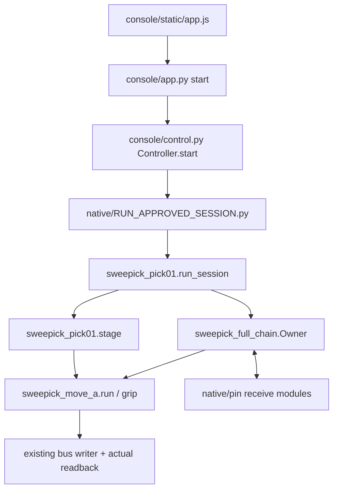

# 실행 경로와 검토 순서

## 1. 웹에서 기존 owner로 전달

`Controller.start()` 검토 시 승인 소비, 중복 owner, source hash 변경, tmux 실행 인자를 확인한다. 브라우저는 port·camera를 직접 열지 않는다. STOP은 기존 owner의 STOP 파일/중단 계약에 전달되며, BUS_LOST를 자동 HOME/OFF로 바꾸지 않는다.

## 2. Import 우선순위

`RUN_APPROVED_SESSION.preload_sources()`는 canonical field readers를 먼저 로드하고, revised trajectory와 selected revision을 명시적으로 바인딩한다. 그래서 [support/field_tools](../support/field_tools)와 [native/revision](../native/revision)은 같은 이름이 있어도 역할이 다르다. 파일명만 보고 둘 중 하나를 최신이라고 추측하지 않는다.

launcher는 `SWEEPICK_RECEIVE_DIR=<prepared root>/pin`을 설정한다. `sweepick_full_chain.codex()`라는 기존 호환 loader 함수가 선택하는 실제 receive 구현은 [native/pin](../native/pin)이다. 옛 기본 fallback 경로를 현재 선택본으로 취급하지 않는다. 공개 사본의 기본 경로는 장비 배포 설정이 아니다.

프로젝트 runtime dependency는 [support/tjj_runtime](../support/tjj_runtime)에 필요한 소스 import 관계를 따라 모았다. `physics_ik`, `integration_scenes`, `sim_data_factory.teacher`, factory의 task manager/receive 구현을 포함한다. LeRobot/서보 SDK와 camera helper는 vendor하지 않았다.

## 3. CLOSE 바인딩

1. `sweepick_pick01.stage()`의 `closing_check()`가 현재 scene과 arm pose에서 전체 closing sweep을 검사한다.
2. `sweepick_move_a.grip()`은 CLEAR, 기존 arm 1-tick 조건과 sweep 포함 조건을 확인한다.
3. 불일치할 때만 같은 callback을 한 번 호출한다.
4. callback 후 actual/Status/Torque를 다시 읽고 같은 binding을 검사한다.
5. 통과해야 최초 gripper Goal 및 기존 Torque 절차에 도달한다.

관련 검사는 [test_a16_close_binding.py](../native/revision/test_a16_close_binding.py), [A-17 최초 Goal 검사](../native/tests/a17/test_a17_first_goal.py)에 있다. fixture의 contact와 ACK는 Fake 결과이며 실물 결과가 아니다.

초기 gripper actual이 상한 밖인 후속 사례는 [초기 범위 진입 검수](gripper_initial_range/GRIPPER_INITIAL_RANGE_REVIEW.md)와 [회귀시험](../native/revision/test_gripper_initial_range.py)을 함께 읽는다. `grip()`은 유효 Goal의 ACK/readback과 actual 추종을 구분하고 초기 보정 표본을 Jaw 접촉 기준에서 제외한다. 초기 구간 뒤 기존 바인딩을 다시 확인하며, 불명확한 적용이나 STOP을 정상 접촉·정지 완료로 바꾸지 않는다.

## 4. 관측과 종료 증거

`sweepick_full_chain`의 camera validity/freshness, observation approval 대기와 return support 검사를 함께 읽는다. 손목 카메라는 gripper에 고정되어 회전하므로 image slope와 world yaw를 혼동하지 않는다.

콘솔의 `replay.py`는 기록 시각 이후의 프레임·ACK를 과거 시점에 보이지 않게 한다. `records.py`는 상위 exit와 하위 refused/stopped_by를 분리하고, `inspection.py`는 오류 전후 원본 샘플·이미지와 SHA를 작은 패키지로 만든다. HOLDING, 과거 HELD_CONFIRMED, 현재 파지 증거, 전체 성공, 정상 회수, 별도 OFF와 safe_shutdown을 각각 확인한다.

## 5. 아직 지원되지 않는 범위

현재 launcher의 `run_session(... full_chain=True, scope='RECEIVE_CONTACT')`는 LIFT 한정 종료 옵션이 아니다. 별도 stage CLI를 여러 번 호출하는 것이 continuous owner/recorder session과 동등하다는 증거도 없다. 제한 실물 운영을 추가할 때는 종료 경계와 owner/recorder/torque 계약부터 확인해야 한다. 이 게시 작업에서는 해당 backend를 수정하지 않았다.
