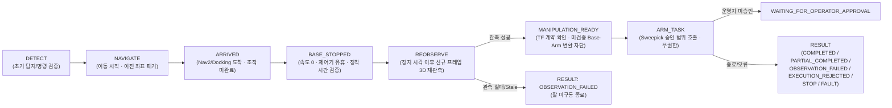

# DAPIER C — VSLAM/NAV2 × Sweepick Visual Servo 인터페이스 및 연결 가능성 감사

- **담당**: Gemini 4 Argon / 독립 C팀
- **기능 구현 마감**: 2026-10-23
- **Navigation 저장소**: `https://github.com/shouttt1320/Dapier_project_visaul_slam` (`origin/main` @ `3416c7c`)
- **Manipulation 저장소**: `https://github.com/Alpenj/DAPIER` (`2ARM_ROBOT/sweepick` @ `42b0640` / B20 @ `992beee`)

---

## 1. Navigation 저장소 6개 핵심 파일 감사 결과

### 1.1 `task_manager.py` (`TaskManagerNode`, `TaskState`)
- **현재 구현**:
  - 상태 기계: `IDLE` → `VALIDATING` → `NAVIGATING` → `VERIFYING` (0.6s 대기) → `DOCKING` → `RECOVERY` → `SUCCESS` / `FAILED`.
  - Nav2 Action (`/navigate_to_pose`) 완료 시 0.6초 `VERIFYING` 후, 일반 `NAVIGATE` 명령이면 즉시 `TaskState.SUCCESS`로 전이하며, `DOCK` 명령이면 `/docking/trigger` 발행 후 `/docking/status`에서 `STATE=DOCKED` 또는 `SUCCESS` 수신 시 즉시 `TaskState.SUCCESS`로 종료함.
- **통합 연결 시 발견된 구조적 결함 (P0 차단 대상)**:
  1. **Nav2/Docking 성공과 조작 성공의 혼동 위험**: `TaskState.SUCCESS`는 베이스 주행/도킹 도착(`ARRIVED`)만을 의미하나 후속 `BASE_STOPPED → REOBSERVE → MANIPULATION_READY → ARM_TASK` 단계가 존재하지 않음.
  2. **이동 전/이동 중 관측 재사용 위험**: `_check_docking_feasibility()`가 `self.latest_target_pose`의 수신 시각 차이만(`time_diff <= 3.5s`) 검사하고, 해당 관측이 **베이스 완전 정지(`BASE_STOPPED`) 이후에 새로 촬영된 프레임인지** 검증하지 않음.

### 1.2 `object_detector_3d.py` (`ObjectDetector3D`)
- **현재 구현**:
  - 입력 토픽: `/camera/color/image_raw` (또는 decompressed), `/camera/depth/image_raw`, `/camera/color/camera_info`, `/qwen/target_bbox`.
  - Stage 1: Qwen VLM BBox / YOLO-World / HSV 색상 앵커 검출.
  - Stage 2: TF2 (`base_footprint ← camera_color_optical_frame`) 변환 후 RANSAC + SVD 3D 평면 피팅(`fit_plane_geometric_score`)을 수행하여 `/docking/target_object_pose` (`PoseStamped`, `camera_color_optical_frame`) 및 `/docking/object_detection_status` 발행.
- **통합 연결 시 발견된 구조적 결함 (P0 차단 대상)**:
  1. **EMA 필터 이력 잔류**: `self.smoothed_pose`에 `ema_alpha = 0.25` 지수이동평균이 적용되어 주행 중 관측 좌표가 정지 후 좌표에 섞임.
  2. **Persistence Latch (0.5초)**: 검출 실패 시 최대 0.5초 동안 직전 좌표를 재발행함.
  3. **Qwen BBox 180초 Latch**: `(time.time() - self.latest_qwen_time) < 180.0` 동안 이동 전에 검출된 2D BBox를 유효한 것으로 재사용함.
  - **해결**: `PostStopReobserveGate`에서 `captured_at_s > stopped_at_s + margin`, `frame_seq > last_nav_frame_seq`, `is_ema_filtered_from_motion == False`, `is_persistence_latched == False`, `qwen_bbox_captured_at_s > stopped_at_s`를 모두 강제하여 이동 전/이동 중 좌표를 100% 무효화함.

### 1.3 `vslam_navigation.launch.py`
- **현재 구현**:
  - `turtlebot3_state_publisher` (`base_footprint` → `base_link` → `camera_link` 등 URDF TF).
  - `camera_to_optical_tf` (`tf2_ros/static_transform_publisher`): `camera_link → camera_color_optical_frame` (`roll=-1.5707963, pitch=0.0, yaw=-1.5707963`).
  - `rtabmap` (`Mem/IncrementalMemory=false`, Localization 전용, `grid_map → /map`).
  - `nav2_bringup/navigation_launch.py` (`nav2_vslam_params.yaml`).
  - `precision_approacher_node` (`precision_docker`).
- **TF 감사**:
  - 커밋 `80fe5b6`에서 미검증 `so101_moveit_config` 및 `turtlebot3_dual_so101` URDF가 제거됨.
  - 따라서 Navigation TF 트리(`map → odom → base_footprint → camera_link → camera_color_optical_frame`)와 Sweepick 조작부 좌표계(`assembled dual model world` ← `arm_datum` ← `aruco_board` ← `top_camera`) 사이의 물리적 변환(`base_footprint ↔ arm_base`)은 **실물 미검증 상태**임.

### 1.4 `command_validator.py`, `semantic_waypoints.yaml`, `station_manager.py`
- **`command_validator.py`**: `ActionEnum`(`DOCK`, `NAVIGATE`, `STOP`, `STATUS`), `TargetSpec`, `RobotIntent` Pydantic 스키마 검증 및 한글 동의어/조사 제거 매칭 수행. 미등록 목적지(`UNKNOWN_WAYPOINT`, `STATION_NOT_FOUND`)를 100% 사전 차단함.
- **`semantic_waypoints.yaml`**: `box_staging`, `desk_staging`, `charger_staging`, `entrance`, `meeting_room` 정의.
- **`station_manager.py`**: `docking_stations.yaml`(`workplace1`, `workplace2`) 및 `templates/*.pcd` 관리, `map ↔ station_local` 양방향 강체 변환(`transform_to_station_local`, `transform_to_map`), `calculate_standoff_pose` 제공.
- **재사용성**: 변경 없이 그대로 `NavigationManipulationBridge`에서 재사용 가능함.

---

## 2. Sweepick Manipulation 계약 감사 결과

| 영역 | 파일 | 핵심 계약 및 안전 불변식 |
|---|---|---|
| **Console Scope** | `console/control.py`, `console/records.py` | 승인된 3개 실행 범위만 허용: `FULL_CHAIN_RECEIVE_CONTACT`, `LEFT_START_TO_LIFT`, `RIGHT_X_FINITE_METROLOGY`. |
| **Single-Owner & 장치 검증** | `console/control.py`, `native/RUN_APPROVED_SESSION.py` | 전용 tmux 세션(`sweepick_console_field`), `fuser` 장치 점유 검사, USB 경로 및 손목 카메라 커버 테스트(`WRIST_IDENTITY_CONFIRMATION.json`), `MANIFEST.json` SHA256 바인딩 필수. |
| **운영자 실행 승인** | `console/control.py` (`prepare`, `start`, `view_decision`) | `prepare()`는 미승인(`approved=False`, `state='PREPARED'`) 세션만 생성함. 실제 실행은 운영자의 현장 확인 후 명시적 `START` 승인 및 추가 관측 이동(`OBSERVATION_MOVE_APPROVAL.json`) 승인이 있어야만 진행됨. |
| **Visual Servo** | `native/revision/sweepick_pick01.py`, `visual_servo/B19_A_INTEGRATION_CONTRACT.md` | 왼팔 PICK은 상단 카메라 ArUco 보드 체인(`T_world_camera`) + 손목 카메라 단계별 정렬(`visual_align`: `01_pregrasp`, `01a_above_block`, `02_descended`, `03_closed`, `04_lifted`)을 사용. B팀 `RightRelativeServoProposal`은 순수 계산(`executable=False, motor_write_authorized=False`)만 수행. |
| **STOP 및 종료 판정** | `console/control.py` (`stop`, `off_confirmed`), `native/revision/sweepick_pick01.py` (`write_limited_terminal`) | `.STOP` 파일 래치 + `SIGINT`/`SIGTERM` 전달. `FULL_CHAIN`은 양팔 모든 관절 `RETURNED_RELEASED` 및 `torque/status/moving/velocity == 0` 확인 시에만 정상 종료(`off_confirmed=True`). `LEFT_START_TO_LIFT`는 왼팔이 LIFT 위치에서 Torque ON 유지(`LIMITED_HOLDING`)로 끝나며 수동 복구 확인(`MANUAL_RECOVERY_CONFIRMATION.json`) 전까지 다음 실행 차단. |

---

## 3. Navigation ↔ Manipulation 연결 아키텍처 요약

