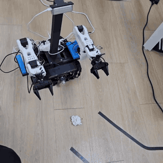

# DAPIER · SWEEPICK과 Physical AI 미니 프로젝트

동국대학교 DAPIER 1기(2026.07.06–11.04, 656시간)에서 한 작업을 **최종 팀 프로젝트 SWEEPICK**과 **미니 프로젝트**, **교육 실습·학습 코드**로 나눠 정리한 저장소다.

**[SWEEPICK](#sweepick-최종-팀-프로젝트)** · **[미니 프로젝트](#미니-프로젝트)** · **[교육 실습·학습 코드](#교육-실습과-학습-코드)** · **[포트폴리오·실물 영상](https://julianjeonresume.netlify.app/)**

## SWEEPICK (최종 팀 프로젝트)



<sub>최종 발표 시연 영상의 4배속 GIF · [원본 MP4(62초)](https://julianjeonresume.netlify.app/assets/video/sweepick-real-full-run.mp4) · [로봇 시점 ACT 실행](https://julianjeonresume.netlify.app/#demo) · [영상 출처](docs/media/README.md)</sub>

청소 전에 바닥의 물체를 집어 치우는 저비용 양팔 모바일 매니퓰레이터다. TurtleBot3 Waffle에 SO-101 양팔과 RGB-D·손목 카메라를 올렸다. 4인 팀 프로젝트이며, **2026-11-01에 사람 개입 없이 이동 → 양팔 ACT 집기 → 이동·놓기 → HOME 복귀를 처음 끝까지 성공**했다.

### 내 역할과 참여도

| 영역 | 참여 | 한 일 |
|---|---|---|
| SIM 데이터·도메인 랜덤화 | **주도** | 143개 위치 시연 → 성공 113궤적 × 외형 5종 = 565뷰, 궤적 단위 Train/Val/Test 분할과 정합 검사 |
| 실물 Sim-to-Real 통합 | **주도** | Native 교사·DAgger 수집, 집게 부하로 집기 판정(잡음 23–26 / 빈손 6–8 tick), 빈손 자동 회수·재시도, 장애 원인별 처리 |
| 베이스↔로봇팔 ROS 2 연동 | **주도** | `/task/ack` · `/task/command`(1회 10cm·30° 제한) · `/sweepick/ready` · heartbeat 2Hz 핸드셰이크, 팔 작업 중 차체 잠금 |
| Custom ACT 학습·평가 | 공동 | 팀원 1명과 200 epoch 학습, 고정 epoch30 모델 143위치 폐루프 평가, 실패 11건 분류 |
| Visual SLAM·Nav2·도킹 | 협업 | 주 담당 팀원과 재접근 한도·정지 조건을 맞춰 집기 단계와 연결 |
| YOLO 인식 · Qwen 명령 | 팀원 담당 | — |

주도는 설계·구현·검증을 맡은 영역, 공동은 팀원과 나눠 진행한 영역, 협업은 다른 담당자의 작업에 참여한 영역이다. 공동·협업 결과는 팀 결과로 적는다.

### 결과

| 구분 | 결과 | 조건 |
|---|---|---|
| 실물 전체 과정 | 2026-11-01 첫 무인 전체 성공 | A 도착 → 양팔 ACT 집기 → B 이동·놓기 → HOME·토크 해제 |
| 실물 물체별 집기 | 3cm 큐브 7/10 · 휴지 8/10 · 원형 고무 7/10 | 최종 발표 기준, 작업공간 안 10회, 물체별 추가 파인튜닝 없음 |
| SIM 폐루프 | 132/143(92.3%) · Test 27/31(87.1%) | 고정 epoch30, temporal ensemble ON(k=0.01), 위치당 1회 |
| 시연이 없던 위치 | 17/21 완료 | Expert가 실패해 학습 데이터가 없던 Train 위치 |

SIM 완료 기준은 **30 mm 이상 Lift → Stow → 물리 2초 Hold**다. 외형(물체 색·배경/테이블 텍스처·조명)은 랜덤화하고 물체 크기 40 mm·yaw·물성·카메라 보정은 고정했다. 청소·충전의 실물 연결과 같은 세팅의 연속 성공률 측정은 남아 있다. 선택의 이유와 한계는 [포트폴리오의 WHY·PAAR](https://julianjeonresume.netlify.app/#projects)에 정리했다.

### 코드와 관련 저장소

| 위치 | 내용 |
|---|---|
| [2ARM_ROBOT](2ARM_ROBOT/README.md) | SWEEPICK 양팔 SIM·데이터 검증·실물 연동 코드와 실험 문서. [CUSTOM ACT V1 기록](2ARM_ROBOT/docs/CUSTOM_ACT_V1_KO.md) 포함 |
| [so101_ros2](so101_ros2/README.md) · [contracts](contracts/README.md) | C++ 관절·지역화 계약과 ROS 2 노드, 언어 간 데이터 계약 |
| [`pro/sweepick-*` 브랜치](https://github.com/Alpenj/DAPIER/branches/all?query=sweepick) | 실물 실행기 검토 브랜치(`main` 미병합) |
| [shouttt1320/Dapier_project_visaul_slam](https://github.com/shouttt1320/Dapier_project_visaul_slam) | 팀원 저장소(협업): 이동 베이스의 Visual SLAM·Nav2·Dual ArUco 도킹·YOLO/Qwen 바닥 물체 접근 |

| 분야 | 사용 기술 | 코드·기록 |
|---|---|---|
| 언어·개발 환경 | Python · C++ · Linux(Ubuntu) · Git | [Python 연구 계층](2ARM_ROBOT/research/README.md) · [C++ 관절 코어](so101_ros2/dapier_so101_core/src/joint_model.cpp) |
| 로봇·비전 | ROS 2 · TF · URDF/RViz · OpenCV · RGB-D | [ROS 2 스택](so101_ros2/README.md) · [관측 출처 계약](2ARM_ROBOT/research/OBSERVATION_PROVENANCE.md) |
| 학습·시뮬레이션 | PyTorch · LeRobot/ACT · MuJoCo · RoboTwin | [CUSTOM ACT V1](2ARM_ROBOT/docs/CUSTOM_ACT_V1_KO.md) |
| 장치 연동·데이터 | SO-101/STS3215 · Serial · 관절 tick↔rad · 서보 부하 | [상태 조회 기록](2ARM_ROBOT/docs/evidence/dual_arm_read_only_summary_20260820.json) |

## 미니 프로젝트

SWEEPICK과 별개로 진행한 작업이다. 각 폴더 README에서 교육 원본과 직접 구현·실험을 구분한다.

| 프로젝트 | 구분 | 한 일 | 위치 |
|---|---|---|---|
| deepThinkCar 후보 평가·정지 조건 | 개인 실험 | 카메라·차선 상실 정지와 watchdog, 같은 분할 조향 MAE 14.93°→4.93° 확인 후 평가 범위가 좁아 실차 적용 보류 | [deepThinkCar_mini](deepThinkCar_mini/README.md) · [PR](https://github.com/JD-edu/deepThinkCar_mini/pull/1) |
| CardBench | 개인 실험 | 양팔 카지노 딜러 아이디어를 위한 소프트웨어 실험 | [casino_dealer](casino_dealer/README.md) |
| SO-101 sim-first G0–G1 | 개인 실험 | 한 팔 SO-101의 SIM 첫 학습·scripted pick 기록 | [dapier_sim_first](dapier_sim_first/README.md) |
| ROS 2 차동구동 로봇 | 실습 | URDF·물리 장면·TF·SLAM·Nav2를 한 흐름으로 확인한 Jazzy 워크스페이스 | [ros_dd_ws](ros_dd_ws/README.md) |
| TurtleBot3 SLAM·Nav2 | 실습 | Humble·Gazebo Classic 예제를 Jazzy·Gazebo Harmonic으로 옮기며 메시지·플러그인 차이 진단 | [turtlebot3_ws](turtlebot3_ws/README.md) |
| ROS 2 + Arduino 4축 로봇암 | 실습 | ROS 2 JointState를 Arduino 시리얼 명령과 servo 각도로 연결 | [ros_arm](ros_arm/README.md) |
| jdcobot100 시뮬레이션 | 실습 | 실제 장비 연결 전 관절·모델·컨트롤러·launch 흐름 확인 | [jdcobot100_sim](jdcobot100_sim/README.md) |

## 교육 실습과 학습 코드

| 위치 | 내용 |
|---|---|
| [so101_imitation_learning](so101_imitation_learning/README.md) | PyTorch → Transformer → ACT → SO-101·MuJoCo를 이어 읽는 학습용 포크 |
| [so101](so101/README.md) | SWEEPICK 이전 한 팔 학습·접촉 모델·장치 연결 초기 기록 |
| [docs/LEARNING_GUIDE_KO.md](docs/LEARNING_GUIDE_KO.md) | 강의에서 배운 기술과 프로젝트 적용의 연결 |
| [docs](docs/) · [project-planning](project-planning/) | 하드웨어 안전 절차, 포크 통합 기록, 기획 자료 |

## 장비 없이 먼저 확인하기

Python 3.12 환경에서 저장소 루트의 연구 계층 테스트를 실행할 수 있다. 관측 출처, 명령 형태·TTL, 지역화 상태와 깊이 기반 좌표 변환을 확인하며 장치를 열지 않는다.

```bash
git clone https://github.com/Alpenj/DAPIER.git
cd DAPIER
python3 -m unittest discover -s 2ARM_ROBOT/research/test -v
```

2026-10-28에 Windows·Python 3.12에서 33개 테스트를 확인했다. ROS 2·MuJoCo 실행은 [연구 계층](2ARM_ROBOT/research/README.md)과 각 모듈의 환경 안내를 따른다. 실물 보정·제어는 [하드웨어 안전 절차](docs/HARDWARE_SAFETY_KO.md)를 먼저 확인한다.

## 기록을 읽을 때

- **SIM / MOCK / HW**를 구분한다. 테스트 통과, 예측오차와 실제 작업 완료는 서로 다른 결과다.
- 공개 `main`과 검토 브랜치의 구현 범위가 다르다. 결과에 연결한 revision과 실행 조건을 함께 확인한다.
- 교육 예제·외부 코드·자산의 출처는 각 폴더에 보존한다. 이전 학습 포크를 옮긴 내역은 [통합 기록](docs/FORK_MIGRATION_20260907_KO.md)에 있다.

문서 정리 기준일: 2026-11-03(최종 발표 결과와 역할 표 반영). 코드·런타임·보정값은 변경하지 않았다.
