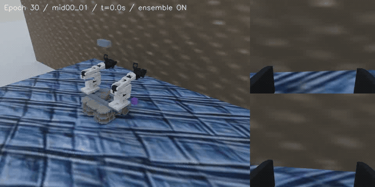

# DAPIER · Physical AI와 로봇 소프트웨어

동국대학교 DAPIER 1기에서 배운 내용을 로봇 연동·시뮬레이션·학습 데이터 검증으로 확인하며 기록하고 있다. 대표 팀 프로젝트 **SWEEPICK**에서는 청소 경로의 작은 물체를 옮기는 양팔 모바일 매니퓰레이터를 만든다.



<sub>CUSTOM ACT V1 대표 SIM 실행 · 고정 epoch30 · temporal ensemble ON · Test mid00_01 한 위치의 기록 · [원본 MP4](https://julianjeonresume.netlify.app/assets/custom-act-v1/sim-test-mid00_01.mp4) · [평가 조건과 143회 결과](2ARM_ROBOT/docs/CUSTOM_ACT_V1_KO.md) · [영상 출처](docs/media/README.md)</sub>

**[SWEEPICK 프로젝트](2ARM_ROBOT/README.md)** · **[교육·실습 안내](docs/LEARNING_GUIDE_KO.md)** · **[포트폴리오·이력서](https://julianjeonresume.netlify.app/)**

## 무엇을 했는가

ACT는 팀원과 **공동 개발·검증**했다. 나의 주 담당은 **모방학습·시뮬레이션·Sim-to-Real·데이터 검증**이며, **Visual SLAM은 협업으로 참여**했다. 외부 교육 코드와 라이브러리는 원본 출처 및 변경 이력과 함께 읽는다.

| 분야 | 사용 기술 | 코드·기록 |
|---|---|---|
| 언어·개발 환경 | Python · C++ · Linux(Ubuntu) · Git | [Python 연구 계층](2ARM_ROBOT/research/README.md) · [C++ 관절 코어](so101_ros2/dapier_so101_core/src/joint_model.cpp) |
| 로봇·비전 | ROS 2 · TF · URDF/RViz · OpenCV · RGB-D | [ROS 2 스택](so101_ros2/README.md) · [Visual SLAM·이동 모듈](https://github.com/shouttt1320/Dapier_project_visaul_slam) |
| 학습·시뮬레이션 | PyTorch · LeRobot/ACT · MuJoCo · RoboTwin | [CUSTOM ACT V1](2ARM_ROBOT/docs/CUSTOM_ACT_V1_KO.md) · [교육 코드](so101_imitation_learning/README.md) |
| 장치 연동·데이터 | SO-101/STS3215 · Serial · 관절 tick↔rad · state/action 검증 | [상태 조회 기록](2ARM_ROBOT/docs/evidence/dual_arm_read_only_summary_20260820.json) · [관측 출처 계약](2ARM_ROBOT/research/OBSERVATION_PROVENANCE.md) |

## 핵심 결과

| 확인한 내용 | 결과와 조건 | 근거 |
|---|---|---|
| 데이터 구성 | 원본 113궤적 × 외형 5종 = 565뷰. 같은 궤적의 외형은 같은 train/val/test 분할에 유지 | [데이터·분할](2ARM_ROBOT/docs/CUSTOM_ACT_V1_KO.md#1-데이터-수집--동작을-보존하고-외형을-바꿨다) |
| ACT 학습 | 200 epoch 완료. best validation은 epoch103, prior normalized L1 0.01553 | [학습 조건·곡선](2ARM_ROBOT/docs/CUSTOM_ACT_V1_KO.md#2-학습--학습-곡선과-작업-완료를-따로-확인했다) |
| 고정 모델 SIM 평가 | 별도로 고정한 epoch30으로 143개 위치 각 1회 중 **132/143, 92.3%** 완료. Test 위치 **27/31, 87.1%** | [위치별 CSV](2ARM_ROBOT/docs/evidence/custom_act_v1_20261027_positions.csv) · [조건·집계 JSON](2ARM_ROBOT/docs/evidence/custom_act_v1_20261027_summary.json) |
| 실패 분석 | 완료하지 못한 11회는 grasp/lift 7회, stow 4회. 예측 청크·관절 명령·실측값·영상을 대조 | [추론 실행 분석](2ARM_ROBOT/docs/CUSTOM_ACT_V1_KO.md#4-분석--예측-청크가-명령이-되는-과정을-추적했다) |
| 실물 연동 | Native 교사 120/198회, 실물 데이터 ACT TJJ v2 관절 예측오차 3.30°, DAgger 교정 시연 16개를 별도 기록. 10/27에는 모터 명령 없는 정지 shadow 확인 | [실물 트랙과 후속 연동](2ARM_ROBOT/README.md#실물-데이터와-실행기-연동) |

SIM 완료 기준은 **30 mm 이상 Lift → Stow → 물리 2초 Hold**다. 외형은 랜덤화하고 물체 크기 40 mm·yaw·물성·카메라 보정은 고정했다. 위 평가 모델은 200 epoch 최종 모델과 구분한다. 물체 이동·청소·저전력 복귀·도킹·충전 전체 흐름은 시뮬레이션에서 구현했고, 현재 실물 기능을 통합하고 있다.

## 프로젝트와 교육 코드를 찾는 순서

| 보고 싶은 내용 | 시작점 |
|---|---|
| 로봇 구성, 구현 범위, 실행기와 연구 결과 | [SWEEPICK](2ARM_ROBOT/README.md) |
| 수집 → 학습 → 추론 → 분석의 조건과 근거 | [CUSTOM ACT V1 연구 기록](2ARM_ROBOT/docs/CUSTOM_ACT_V1_KO.md) |
| RGB-D·관절 데이터 계약, 정책 제안과 C++ 실행 경계 | [Python 연구 계층](2ARM_ROBOT/research/README.md) · [제어 계약](contracts/README.md) |
| 강의에서 배운 기술과 프로젝트 적용의 연결 | [DAPIER 교육·실습 안내](docs/LEARNING_GUIDE_KO.md) |
| 예전 장비·실험·실패·후보 브랜치 | [프로젝트 문서 목록](2ARM_ROBOT/docs/README.md) · [이전 조작 연구](2ARM_ROBOT/docs/RESEARCH_SUMMARY_KO.md) |

## 장비 없이 먼저 확인하기

Python 3.12 환경에서 저장소 루트의 연구 계층 테스트를 실행할 수 있다. 관측 출처, 명령 형태·TTL, 지역화 상태와 깊이 기반 좌표 변환을 확인하며 장치를 열지 않는다.

```bash
git clone https://github.com/Alpenj/DAPIER.git
cd DAPIER
python3 -m unittest discover -s 2ARM_ROBOT/research/test -v
```

2026-10-28에 기존 소스 그대로 Windows·Python 3.12에서 33개 테스트를 확인했다. ROS 2·MuJoCo 실행은 [연구 계층](2ARM_ROBOT/research/README.md)과 각 모듈의 환경 안내를 따른다. 실물 보정·제어는 [하드웨어 안전 절차](docs/HARDWARE_SAFETY_KO.md)를 먼저 확인한다.

## 기록을 읽을 때

- **SIM / MOCK / HW**를 구분한다. 테스트 통과, 예측오차와 실제 작업 완료는 서로 다른 결과다.
- 공개 `main`과 고정 후보·검토 브랜치의 구현 범위가 다르다. 결과에 연결한 revision과 실행 조건을 함께 확인한다.
- 교육 예제·외부 코드·자산의 출처는 각 폴더에 보존한다. 이전 학습 포크를 옮긴 내역은 [통합 기록](docs/FORK_MIGRATION_20260907_KO.md)에 있다.

DAPIER 교육: **2026.07.06–11.04 · 수강 중 · 총 편성 656시간**. 문서 정리 기준일: 2026-10-28.
